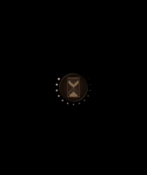
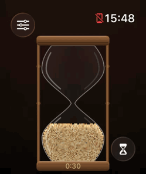
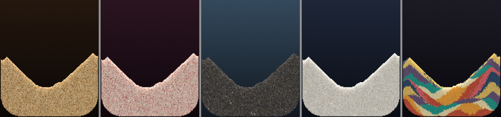
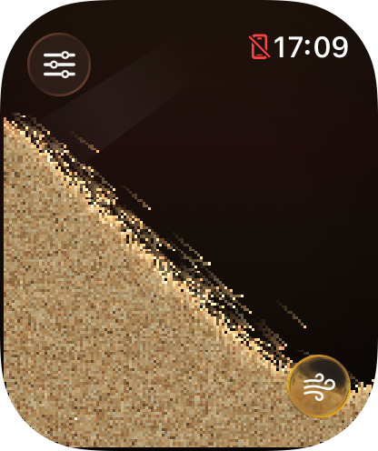

# Hourglass

A pocket of sand on your wrist. Tilt your wrist and it pours; flick it and the sand slams into the glass
and you feel it hit. Or turn on the hourglass, turn your wrist over, and let a minute run through the
neck.

<p>
  
  &nbsp;
  
</p>

A standalone Apple Watch app (watchOS 10+), written in SwiftUI with a falling-sand simulation of its own.

## Playing with it

**Sandbox** — the whole screen is a box of sand.

- **Tilt** your wrist and the sand flows downhill, holding real slopes as it settles. Hold the watch
  flat and it stays put.
- **Flick** your wrist and it flies, splashes off the glass and patters back down. Hard hits come
  through as taps on your wrist.
- **Tap** the screen to scatter the sand around your fingertip; **drag** to plough through it. With the
  watch held flat, what you draw stays drawn.
- Turn the **Digital Crown** to pour more sand in, or let some out.
- **Double tap** (Series 9 / Ultra 2 and later) or press the button in the corner for a fountain.

**Hourglass** — a glass hourglass in a wooden frame.

- **Turn it over** with the button or a double tap, or simply turn your wrist upside down. The sand runs
  through the neck at a metered rate, so it empties in exactly the time you set, and the time left is
  engraved on the bottom cap.
- The **Digital Crown** sets the time, from 30 seconds to an hour. Turn it over halfway and it keeps
  time from where it is, just like a real one.
- When the last grain falls, it **taps your wrist**, even with the screen off: a running hourglass keeps
  the app alive as a mindfulness session, and catches up on the sand when you look again. On the
  always-on display it keeps running, a second at a time: the crater deepens, the cone grows and the
  time counts down.

**Sands** — Sahara, Pink Beach, Black Sand (with glinting volcanic glass), White Sands and Sand Art,
which pours in coloured layers that fold as you tilt. In three grain sizes.



## How the sand works

Each grain is a cell in a grid (138 × 165 of them on a 46 mm watch at medium grain) with its own
velocity. Every frame, three times over:

- **Forces.** The accelerometer's reading — Core Motion's `gravity + userAcceleration` — is exactly what
  a loose grain inside the watch feels: gravity, plus the opposite of the watch's own acceleration. So
  a flick to the right sends the sand left, then slams it right as your wrist stops. Friction against
  the glass the sand lies on means a nearly flat watch holds it still, and bumps into the screen make
  it hop.
- **Moving.** Grains step cell by cell along their velocity, furthest along gravity first so falling
  columns move as one. Fast grains bounce and kick what they hit (craters, splashes). A grain falling
  in behind a moving one just follows it, so a stream stays a stream.
- **Settling.** A blocked grain may deflect to a neighbouring cell only if that's within about 56° of
  where it was heading. That one rule gives the sand an angle of repose of about 34°: piles hold their
  slopes, and a gently tilted bed stays put. Tipped well past that, grains roll up and over their
  neighbours, so a level bed avalanches instead of jamming against the far wall.
- **Glass.** Glass is slicker than sand: grains slip off shallow glass ledges, so an hourglass empties
  completely. The neck lets grains through only by spending tokens, which are handed out at the rate
  that empties a bulb in the chosen time.

Holes left by grains leaving through the neck rise straight up and surface in the middle, so the top
bulb opens a crater and the bottom one builds a cone — the way real hourglasses do. Getting that right
took a few rules about who gets first go at a hole; the tests pin them down.

The renderer lights each heap from against gravity, so surface grains catch the light and deep sand
sits in shade, flashes the odd glinting grain, and smears fast grains into short streaks so a trickle
reads as a stream. The sand is drawn as an image, one pixel per grain, between the glass and the frame,
which are drawn once.

Most of a pile is buried and can't go anywhere, so the simulation reads the grid eight cells at a time
and steps over empty air and buried sand in one go; it only does the real work for grains at the
surface or in flight. A frame in which nothing visibly changed isn't drawn again, and once the sand is
at rest and the watch is still, the simulation goes to sleep and the render loop slows to a few checks
a second. With the screen dimmed, nothing runs but the hourglass's once-a-second catch-up.

The tests pin all this down: besides checking how the sand behaves, they hash the whole world through
scripted scenes, so a change meant only to make things faster has to leave the sand exactly as it was.

## Building

You'll need Xcode 26 and [XcodeGen](https://github.com/yonaskolb/XcodeGen) (`brew install xcodegen`).

```sh
scripts/build.sh                 # generate the project and build for the watch simulator
scripts/build.sh --run           # ...and launch it in the simulator (with gravity swaying, see below)
scripts/build.sh --device        # build for a real watch
scripts/test.sh                  # run the simulation tests
scripts/preview.sh               # render scenes to preview/ without a watch: stills, sheets, GIFs
scripts/preview.sh bench         # time the simulation and the renderer (--case held, --grain 3, ...)
scripts/preview.sh icon          # re-render the app icon from the simulation
```

`taskpolicy -b scripts/preview.sh bench` runs the benchmark on the Mac's efficiency cores, which are a
fair stand-in for a watch's.

**On your watch:** run `xcodegen generate`, open `HourGlass.xcodeproj`, pick the HourGlass scheme and
your Apple Watch as the destination, and run. It's signed automatically with the team in
`project.yml`. Debug builds are fine: the simulation package is always compiled optimized.

**In the simulator** there are no motion sensors, so these launch arguments help:

| Argument | Effect |
| --- | --- |
| `-demo` | Sways gravity from side to side, turning it upside down now and then |
| `-mode hourglass` / `-mode sandbox` | Starts in that mode (any setting can be passed this way) |
| `-palette art` | `sahara`, `coral`, `volcanic`, `gypsum` or `art` |
| `-grain 2` | Grain size in pixels: 2, 3 or 4 |
| `-timerSeconds 30` | The hourglass's time |
| `-turnOver` | Turns the hourglass over 1.5 s after launch |
| `-openSettings` | Opens the settings sheet |

Here it is in the Apple Watch simulator with `-demo`, mid-avalanche:



## Layout

- `App/` — the watch app: the render loop and touch (`SandScreen`), the frame-by-frame controller
  (`SandController`), where the sand sits on screen (`SandLayout`), the hourglass's glass and wood
  (`SandDrawing`), Core Motion, haptics and the background session.
- `Packages/HourGlassCore/` — everything that doesn't need a watch: the simulation (`SandWorld`),
  container shapes, palettes, the renderer and the motion-to-forces mapping, with tests, and
  `sandpreview`, which renders scenes on the Mac.
